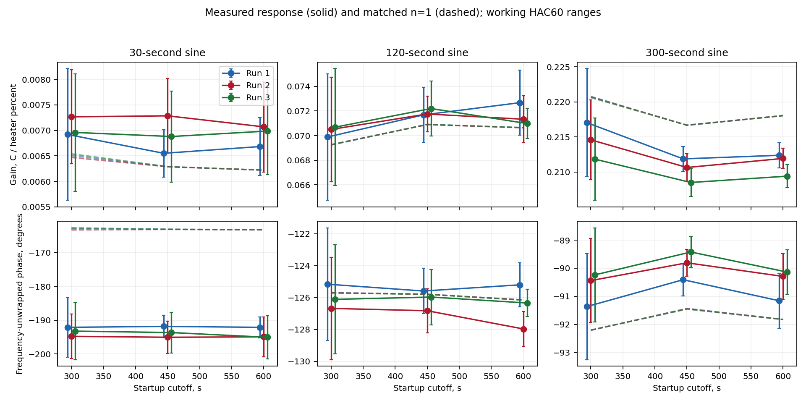

# What explains the shared TC-Lab model discrepancies?

Status: investigation draft. The matched stage comparison under the revised
mean assumptions is still running. The completed results below have numerical
audits; the final synthesis and requirement audit remain pending.

The fast residual cycle points to missing dynamic structure in the original
two-pole formulation. A shared command-map/transport model with bounded linear
ambient variation fits the twelve records at 0.388 C RMSE, versus 0.483 C for the
original n=1 formulation. This is retrospective pooled fitting. We have not
established a unique physical explanation or a calibrated universal error model.

| Question | Evidence | Status |
|---|---|---|
| Does the reference reproduce? | Independent means and likelihood agree; RMSE 0.48320 C | Complete |
| Is the fast cycle repeatable? | All three fast-sine repeats share a phase-aligned pattern | Complete descriptive analysis |
| What response feature is missing? | About 28–32 degrees of extra phase lag at the 30-second input | 54 estimates independently audited |
| Can linear dynamics explain it? | Unequal positive lags and explicit transport are alternatives; free numerators also fit but are unstable to bounds | Selected fits audited |
| What changes with nonlinearity and ambient? | A modest shared command curve plus affine ambient improves trajectory fit | Selected means audited; residual assessment pending |
| Does stage preference survive the revised mean? | Matched n=1/2/3 and unequal-stage reruns underway | In progress |

## The fast discrepancy is larger than parameter uncertainty

Measured frequency responses use the actual held input, three startup cutoffs
and two nuisance treatments. At 450 s, the fast-sine phase differs from matched
n=1 by about −29, −32 and −31 degrees across repeats. The corresponding
working HAC phase SDs are about 1.7, 2.4 and 3.1 degrees. The discrepancy remains
across the other windows. The slower tests have much smaller phase differences;
only 1–2 settled cycles remain in the 300-second tests.

A positive two-real-pole transfer has phase between 0 and −180 degrees at
positive frequency. The fast measured response is near −193 degrees on the
independently unwrapped branch, or +167 degrees as a principal phase. Under the
steady LTI interpretation, adjusting only its three positive parameters cannot
match that phase. The original model's conditional local phase SD is only
0.14 degrees at this frequency. Precise parameters therefore do not establish
an adequate response structure.

See the [frequency estimates](results/frequency/frequency_estimates.json),
[all-estimate audit](results/frequency_audit/audit.json), and
[phase-aligned repeats](results/frequency_figures/phase_repeats.png).

## What the model comparisons establish so far

All rows use the same twelve records, input holds, startup convention, ambient
reference and OU-plus-measurement family. Numeric covariance parameters are
reestimated. Main variable-projection fits use 24 starts; the nonlinear heat-loss
check uses twelve, including another thermal-role basin. Labels mentioning
linear ambient use two bounded endpoint offsets per run; the other rows use
one constant offset. Parameter counts include nuisance terms and noise scale.

| Model | Raw RMSE, C | Negative log likelihood | Nominal parameter count |
|---|---:|---:|---:|
| n=1 equal chain | 0.483 | -7927.2 | 18 |
| n=2 equal chain | 0.972 | -8237.0 | 18 |
| n=3 equal chain | 1.188 | -7744.8 | 18 |
| Flexible three-state real-pole benchmark | 0.911 | -8426.8 | 21 |
| Flexible four-state real-pole benchmark | 0.854 | -8449.3 | 23 |
| Three unequal positive poles | 0.908 | -8402.8 | 19 |
| Two poles plus transport delay | 1.034 | -8396.8 | 19 |
| Transport plus linear ambient | 0.750 | -8406.5 | 31 |
| Command map plus transport | 0.647 | -8426.5 | 20 |
| Command map, transport and linear ambient | 0.388 | -8439.3 | 32 |
| Quadratic heat loss plus transport | 0.734 | -8411.7 | 20 |

Lower negative log likelihood is better under the working Gaussian law, but it
can accompany worse raw temperature error because the fitted disturbance also
changes. The initial n=2 fit suppresses part of the fast cycle while increasing
raw RMSE. Fixed-covariance and IID sensitivities preserve the conclusion that
these equal-stage increases do not improve raw RMSE under the initial mean.
The final matched reruns will test stage preference after adding the command
map and linear-ambient convention.

The flexible three-state model nearly matches the fast phase, but reaches a
numerator bound and uses a poorly estimated fast pole. Widening the coefficient
bounds moves that pole from 0.14 to 0.07 to 0.04 s with almost unchanged
likelihood and gain. It has nonminimum-phase zeros and a sign-changing early
impulse. This supports revisiting the constrained dynamics, without identifying
those states as thermal mechanisms. A local full-rank sensitivity matrix does
not make those parameters practically estimable.

Positive alternatives avoid that interpretation. Three unequal poles fit at
approximately 142.5, 13.6 and 3.0 s; swapping the last two preserves all predicted
trajectories and likelihood. Two poles with an effective additional delay fit
d near 2.53 s. The nominal profile support is 2.41–2.65 s under that model;
physical transport and acquisition timing are not separated by this parameter.

## Two nonlinear explanations and ambient variation

The shared command curve is u_eff=u+c*u*(1−u/100), followed by positive delayed
linear dynamics. The fitted constant-ambient c is about 0.097; nominal profile
support is 0.074–0.121. With affine ambient, c is about 0.109 and d about 2.54 s.
For ideal 50+50 sin input this map changes the mean and adds a second harmonic,
while preserving the fundamental. It therefore tests step/sine gain differences
and harmonics. A constant alpha multiplier remains absorbed into K; command
curvature is a separate response hypothesis.

The temperature-dependent alternative adds −beta*v² to the thermal balance,
with beta about 0.0025 per C. Its scoped nominal profile support is 0.0016–0.0036 per C. This
is a phenomenological heat-loss term, not an identified radiation coefficient.
The command-map alternative has better working likelihood and raw error in this
comparison, but that does not prove where the nonlinearity occurs physically.
Both structures have grounding in established modeling approaches: a
[static input map followed by linear dynamics](https://www.mathworks.com/help/ident/ref/idnlhw.html),
and [nonlinear TC-Lab heat loss](https://apmonitor.com/pdc/index.php/Main/TCLabRadiative).

Affine ambient reduces raw error substantially after revising dynamics, but its
nominal AICc advantage in the command-map case is only about 1.5. The additional
ambient flexibility is not decisive evidence of physical room-temperature drift.
Model discrepancy and ambient variation remain confounded without independent
ambient measurements.

## Error structure and the limits of these uncertainty ranges

A descriptive nested projection assigns roughly 38% of reference SSE to per-run
means, another 36% to linear trends, 10% to sine fundamentals and 16% to the
remainder. These fractions depend on projection order; they do not allocate
causal fractions to ambient or measurement noise.

Conditioning on temperature history reduces reference one-second RMSE from
0.484 C to 0.117 C on identical targets. At 300 s the errors are 0.529 C and
0.483 C. Parameters and ambient offsets were fitted to the full records, so this
shows the effect of retrospective measurement conditioning, not independent
forecast validation. See [forecast diagnostics](results/reference_diagnostics_v2/diagnostics.json).

The regularized impulse-response fits support mostly positive response shapes
with modest smoothing. The best descriptive raw error is about 0.451 C. Their
early response and tails depend on lag bins, horizon and penalty; these
sensitivities are not confidence bands or sub-bin delay estimates. They also
condition on the reference ambient/noise model, so their score is not another
joint likelihood competitor. See [FIR audit](results/fir_audit/audit.json).

All reported profile support is nominal, bounded working-likelihood support;
no coverage guarantee follows under misspecification or data-dependent model
selection. Local information fixes covariance and allows unrestricted nuisance
directions even at bounds. Residual input association, remaining autocorrelation,
variance changes and quantization still need final assessment for the revised
mean models. No untouched validation set has been created from these records.

## What remains before the recommendation

Finish the matched revised-mean n=1/2/3 and unequal-stage fits, their independent
audits, uncertainty and innovation checks. Then state which explanations these
records support, which remain indistinguishable, and what evidence would resolve
the remaining uncertainty. Restricted-pair calibration, new experiments and
DoE remain for a later researcher decision.

Full equations, bounds, numerical methods and source references are in
[methods.md](methods.md). Current execution and evidence locations are in
[PROJECT.md](PROJECT.md) and [run_manifest.json](run_manifest.json).
