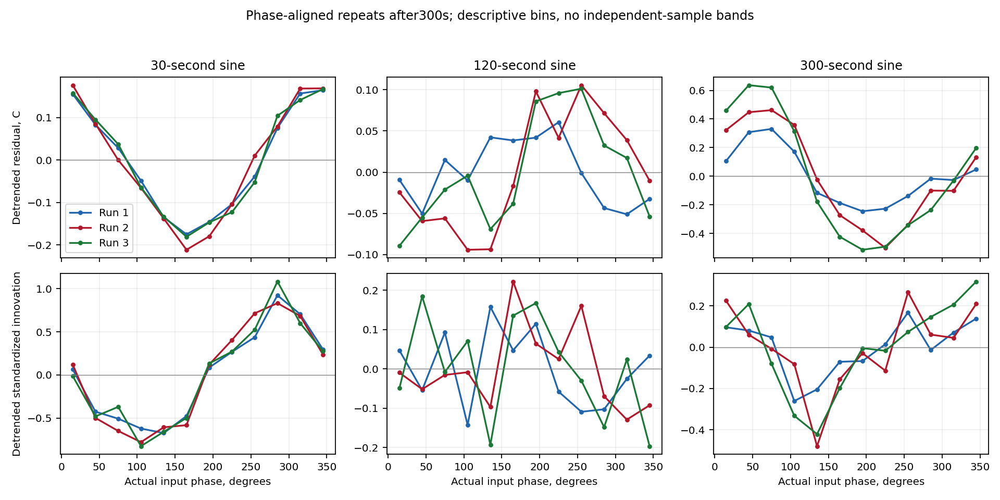

# Shared TC-Lab model investigation

Status: initial diagnostics complete; dynamic-model comparisons are pending.
The [plan](../review/tier0_followup_investigation.md) defines the scope.

| Question | Evidence so far | Status |
|---|---|---|
| Does the saved reference reproduce? | All 12 trajectories and dense likelihood reconstructed; pooled RMSE 0.48320 C | Numerical audit passed |
| Is the fast residual cycle reproducible? | Phase-aligned residuals and innovations show a similar cycle in all three fast-sine repeats | Descriptive evidence; per-run decomposition interpretation pending |
| Does n=1 miss amplitude or phase? | Fast-sine response has approximately 28–32 degrees additional lag across windows, repeats and nuisance treatments | 54 harmonic estimates independently reconstructed |
| Can flexible shared LTI dynamics explain it? | Benchmark not yet fitted | Pending |
| Do n=2 or 3 improve the explanation? | General forward solver passed synthetic/ODE audits | Pooled comparisons pending |
| Are nonlinear or disturbance extensions needed? | Harmonic/operating-condition checks pending | Follow evidence |

## Numerical reference

The independent reference uses augmented matrix exponentials, followed by dense
covariance Cholesky whitening. Its likelihood differs from the saved fit by
4.4e-11. This verifies reproduction, without certifying model adequacy.
See [baseline audit](results/baseline_v2/audit.json).

## Frequency response

The nine sine records were analyzed after 300, 450 and 600 seconds. Each window uses
both an offset-plus-trend nuisance treatment and a sensitivity with exponential
nuisance terms at the pooled reference rates. The latter is conditional on those
rates. The input reference integrates the recorded left-held command exactly.

There are 18 estimates per period: three repeats, three windows and two nuisance
treatments. The fast-sine circular phase difference from the matched n=1
prediction ranges from −32.25 to −28.26 degrees. For 120-second tests it ranges
from −1.82 to +0.95 degrees; for 300-second tests from −0.02 to +2.04 degrees.
Long-period estimates retain only 1–2 cycles, so startup and slow
variation require particular care.

The fast response points toward a reproducible dynamic mismatch. It does not
identify pure delay, an additional thermal state, nonlinear behavior or a
timestamp mechanism uniquely. Those alternatives motivate the next comparisons.

Measured curves use working HAC with 60 sample lags, with 30 and 120 stored as
sensitivities. These are per-record asymptotic uncertainty calculations under a
working residual description; they do not establish calibrated coverage or
independent repetitions. Displayed phase is unwrapped by increasing frequency
independently for each measured/model curve; principal phases remain in the
saved estimates. The chosen branch does not identify a unique transport delay.

The phase-fold plots remove jointly fitted offset/trend terms and show 12 phase
bins after 300 seconds. Bin counts measure sampling density, not independent
experimental replication.

Independent quadrature of the held input and QR regression reconstructed all 54
measured/matched estimates; maximum complex-gain discrepancy is 5.7e-16.
See [estimates](results/frequency/frequency_estimates.json),
[frequency audit](results/frequency_audit/audit.json), and
[error decomposition](results/frequency/error_decomposition.csv).

## Next decisions

Finish per-run error and harmonic checks, then test flexible shared LTI dynamics
and n=1/2/3 chains with matched input, ambient and error conventions. Separate
short-horizon temperature-conditioned prediction from free-run simulation.
Use those results to decide which impulse-response, operating-condition or
disturbance comparisons are needed. Additional calibration pairs remain deferred.
