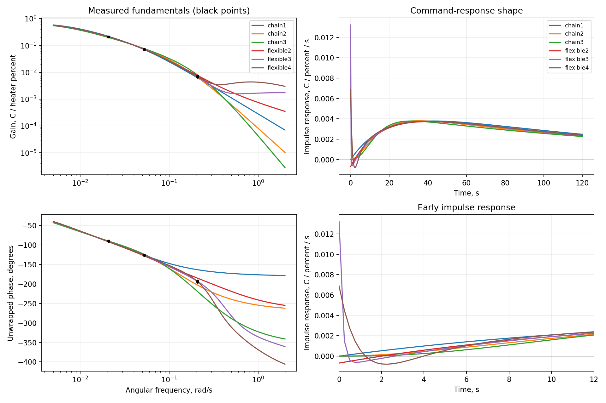
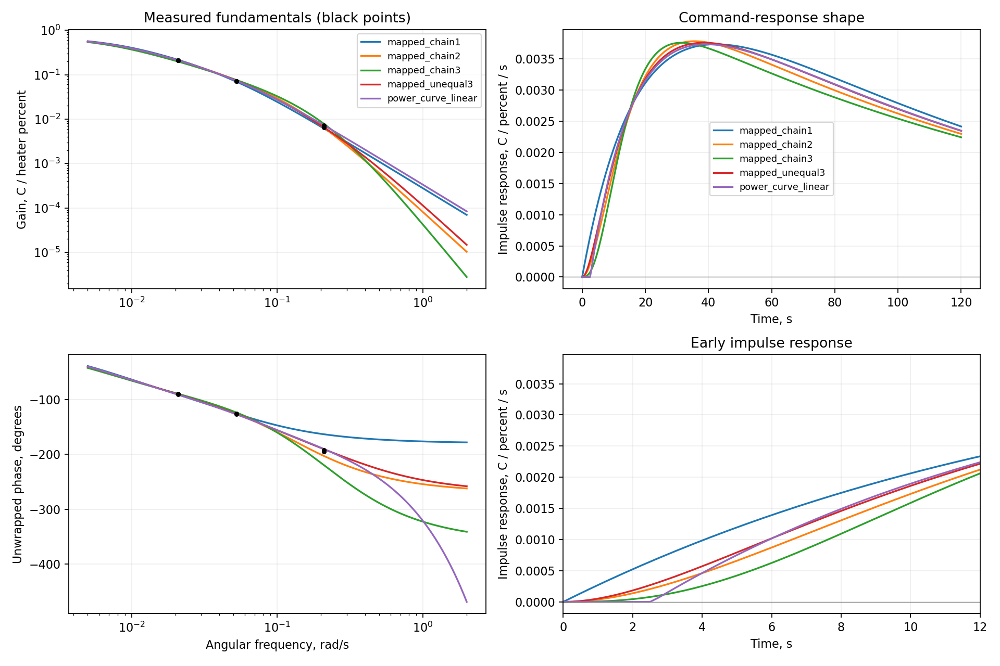
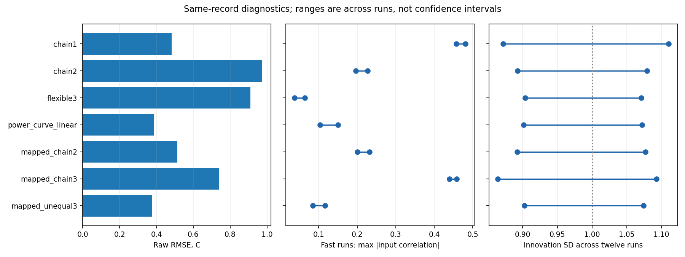
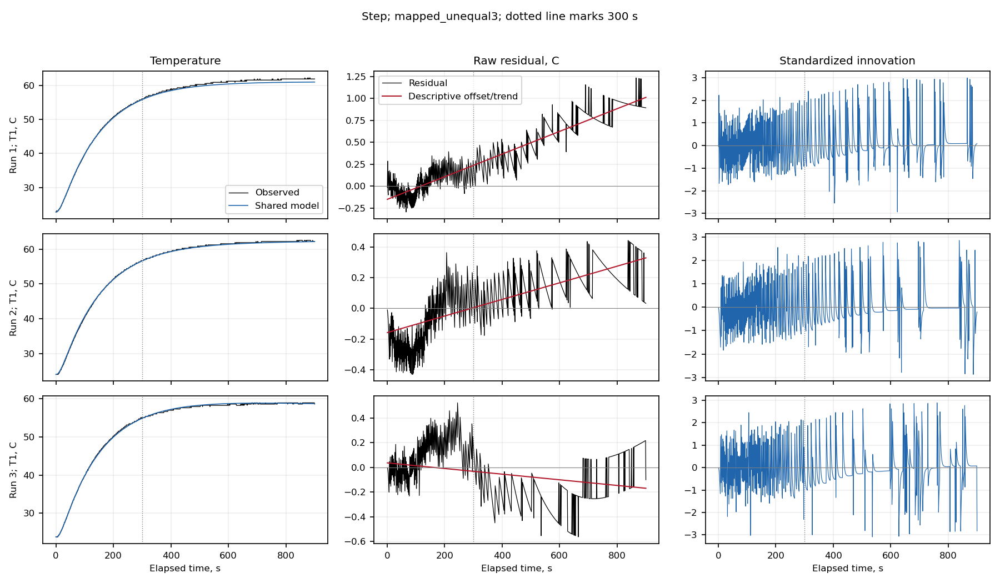
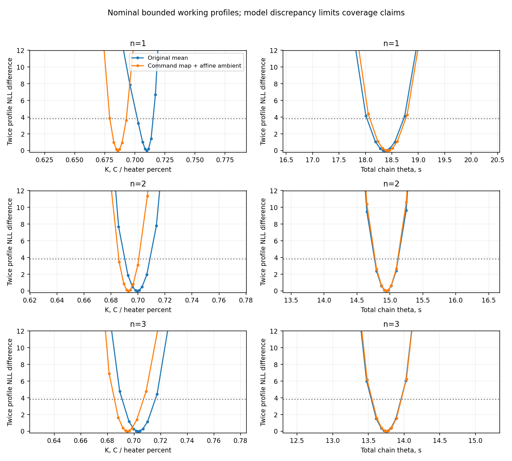

# What explains the shared TC-Lab model discrepancies?

Status: scoped investigation complete for researcher review. Numerical checks and figure review are documented in verification.md.

The original n=1 formulation misses a repeatable fast phase lag. A shared
positive model with unequal lags, a small command curve and bounded affine
ambient fits all twelve ENV2 records at 0.374 C RMSE, compared with 0.483 C for
the reference. Adding more identical delay stages does not resolve the
restriction. The revised model removes much of the fast input-related error,
while remaining autocorrelation, slow bias and temperature quantization prevent
us from claiming an adequate universal stochastic model.

| Phase and question | Evidence | Status |
|---|---|---|
| 0. Does the reference reproduce? | Independently reconstructed means, innovations and likelihood; RMSE 0.48320 C | Verified |
| 1. Is the discrepancy offset, drift or cycling? | All three fast-sine repeats share a phase-aligned cycle; slow trends also remain | Descriptive decomposition complete |
| 2. Is amplitude or phase wrong? | About 28–32 degrees of extra fast phase lag; 54 estimates with window/HAC sensitivities | Independently verified |
| 3. Can flexible linear dynamics explain it? | Free numerators nearly remove fast cycling but identify fast modes poorly | Scoped real-pole benchmark complete |
| 4. Does increasing n help? | n=2 improves working likelihood; n=3 worsens it, including under revised mean assumptions | Matched fits, information and profiles complete |
| 5. Which targeted revision helps? | Unequal positive lags and transport explain extra phase; command curvature and ambient improve level fit | Selected fits independently verified |
| 6. What can we claim? | Shared trajectories improve; residual adequacy and unique mechanisms remain unresolved | Ready for researcher review |

## A repeatable dynamic discrepancy

Measured frequency responses use the actual held command, three startup
cutoffs and two nuisance treatments. At 450 s, the fast-sine phase differs from
matched n=1 by about −29, −32 and −31 degrees across repeats. The corresponding
working HAC phase SDs are about 1.7, 2.4 and 3.1 degrees. The discrepancy persists
across other windows. The 120-second and 300-second tests have much smaller
phase differences; only 1–2 settled cycles remain in the slowest tests.

A positive two-real-pole transfer has phase between 0 and −180 degrees at
positive frequency. The fast measured response is near −193 degrees on the
independently unwrapped branch, or +167 degrees as a principal phase. Under the
steady LTI interpretation, adjusting only the three positive n=1 parameters
cannot match that phase. Its conditional local phase SD is only 0.14 degrees.
These narrow parameter ranges omit the observed structural discrepancy.

The [54 frequency estimates](results/frequency/frequency_estimates.json) and
[independent quadrature/QR audit](results/frequency_audit/audit.json) preserve
the windows, repeat-level uncertainty and phase reference. See also the
[phase-aligned repeats](results/frequency_figures/phase_repeats.png).

## Shared model comparisons

All rows use the same twelve records, actual irregular timestamps, left input
holds, startup convention and OU-plus-measurement family. Numerical covariance
parameters are reestimated. Each main variable-projection fit uses 24 starts;
the quadratic heat-loss fit uses twelve, including another thermal-role basin.
Parameter counts include ambient nuisance values and all noise parameters.
Affine ambient uses two endpoint offsets per run, each within ±2 C; otherwise
each run has one constant offset.

Input–innovation correlation ranges below are per-run maxima of absolute
correlations over leads/lags up to 30 samples. They are descriptive lag searches.

For equal stages, n counts input-delay states and theta is their total mean
delay: G_n(s)=K/[(1+tau*s)(1+theta*s/n)^n]. The full mean model has n+1 states.

| Model | Raw RMSE, C | Negative log likelihood | Parameters |
|---|---:|---:|---:|
| Original n=1 | 0.483 | -7927.2 | 18 |
| Original n=2 | 0.972 | -8237.0 | 18 |
| Original n=3 | 1.188 | -7744.8 | 18 |
| Flexible two-state real-pole | 1.100 | -8322.0 | 19 |
| Flexible three-state real-pole | 0.911 | -8426.8 | 21 |
| Flexible four-state real-pole | 0.854 | -8449.3 | 23 |
| Three unequal positive poles | 0.908 | -8402.8 | 19 |
| Two poles + transport | 1.034 | -8396.8 | 19 |
| Transport + affine ambient | 0.750 | -8406.5 | 31 |
| Command map + transport | 0.647 | -8426.5 | 20 |
| Command map + transport + affine ambient | 0.388 | -8439.3 | 32 |
| Quadratic heat loss + transport | 0.734 | -8411.7 | 20 |
| Command map + n=1 + affine ambient | 0.334 | -7961.1 | 31 |
| Command map + n=2 + affine ambient | 0.514 | -8284.0 | 31 |
| Command map + n=3 + affine ambient | 0.741 | -7785.4 | 31 |
| Command map + unequal three poles + affine ambient | 0.374 | -8447.8 | 32 |

Lower negative log likelihood is better under the working Gaussian law, but it
can accompany worse raw temperature error because the fitted disturbance also
changes. For example, the original n=2 fit has a much longer disturbance time
scale than n=1. Fixed-covariance and IID sensitivities also fail to improve raw
error by increasing equal-stage order under the original mean assumptions.

The revised n=1 fit has the lowest raw RMSE among these joint fits, yet retains
fast input–innovation correlations of 0.458–0.482. For revised n=2 and n=3 they
are 0.201–0.232 and 0.440–0.458. Increasing identical stages therefore leaves a
repeatable dynamic mismatch even after improving the level response.

The flexible three-state benchmark nearly matches fast phase and reduces those
correlations to 0.038–0.064. It reaches a numerator bound and has a weakly
estimated fast pole. Widening coefficient bounds moves that pole from 0.14 to
0.07 to 0.04 s with almost unchanged likelihood and gain. Its nonminimum-phase
zeros and sign-changing early impulse should not be assigned physical meaning.
The four-state benchmark has similar problems. These are stable real-pole
benchmarks; we did not fit an unrestricted LTI family or run a subspace estimator.
The four-state fit retains a better nominal AICc than the positive revisions.
Its weak fast modes, bound sensitivity and larger raw error prevent a clear
physical recommendation from that criterion alone.

## A supported reduced revision, with alternatives

Allowing two different input-lag times gives a positive three-state cascade:

\[
G(s)=\frac{K}{(1+\tau s)(1+\theta_1s)(1+\theta_2s)}.
\]

With the shared command map u_eff=u+c*u*(1−u/100) and affine ambient, the fitted
values are K=0.6886 C/percent, tau=142.8 s, input lags 13.47 and 2.99 s, and
c=0.1018. This is one thermal state plus two unequal lag states. Its raw RMSE is
0.374 C, a 22.6% reduction from the original reference. Fast input–innovation
correlations fall to 0.085–0.116. The two lag labels can be interchanged without
changing any trajectory or likelihood; local full rank does not remove that
exact ambiguity.

The revised n=2 model is the equal-input-lag restriction of this cascade.
Freeing that equality adds one parameter and improves negative log likelihood
by about 164 under the same command-map, ambient and error conventions. This
supports relaxing equal stages. Pole coalescence, label symmetry and the
remaining model mismatch preclude a routine chi-square significance claim.

The transport alternative uses two positive poles plus an effective extra delay.
Without a command curve its fitted d is about 2.53 s, with scoped nominal profile
support 2.41–2.65 s. With the command map and affine ambient it reaches 0.388 C
RMSE and d about 2.54 s. The unequal-lag model has a nominal AICc advantage of
about 17 over that matched transport model. Timing conventions, unmeasured
ambient variation and the remaining noise mismatch qualify that preference;
the delay is not an independent hardware calibration.

For command-map models these curves show the linear dynamic block, which is
also the local response about command 50%. A nonlinear model has no single
global transfer function.

For an ideal 50+50 sin input, the command map adds c[12.5+12.5 cos(2wt)] while
preserving the fundamental. It tests step/sine mean-response differences and a
second harmonic. Constant alpha remains absorbed in K. Estimating another
constant alpha cannot improve these temperature-only fits. The constant-ambient
command-curve profile supports c about 0.074–0.121 under its working likelihood.

The quadratic-loss alternative adds −beta*v² to the thermal balance. Its beta
is about 0.0025 per C, with scoped grid-interpolated support about
0.0016–0.0036 per C. It improves over the linear transport mean, but the command
map has better working likelihood and raw error under matched constant ambient. This does
not identify where the nonlinearity occurs. The structures follow established
[static-map/linear-block identification](https://www.mathworks.com/help/ident/ref/idnlhw.html)
and [nonlinear TC-Lab heat-loss modeling](https://apmonitor.com/pdc/index.php/Main/TCLabRadiative);
we imported no published device calibration values.

Affine ambient improves level fit after revising dynamics. In the transport
command-map comparison its nominal AICc advantage over constant ambient is only
about 1.5 despite the raw RMSE reduction. Neither actual room-temperature drift
nor its slope is measured. Both endpoint bounds are an explicit computational
convention, and model discrepancy can be absorbed by that flexibility.

## Residual structure and uncertainty

A sequential descriptive projection assigns roughly 38% of reference SSE to
per-run means, another 36% to linear trends, 10% to fundamentals and 16% to the
remainder. The fractions depend on projection order and do not assign causal
ambient/noise contributions. The regularized FIR fits also permit mostly
positive response shapes; their best descriptive raw error is about 0.451 C.
Their onset/tails depend on lag bins, horizon and penalty. They condition on the
reference ambient/covariance, so their score is not another joint likelihood
competitor. All 16 FIR cells have an [independent audit](results/fir_audit/audit.json).

The revised unequal-lag model still has a maximum absolute innovation ACF of
0.163 over lags 1–30 and all runs, versus 0.256 for original n=1. Per-run innovation
SDs span 0.903–1.074. The pooled mean square is one by fitted-scale algebra;
that is no adequacy check. Slow biases and quantized step plateaus/pulses remain
visible. Correlations with input shape, temperature and temperature rate, plus
time-block scales, are retained in the [innovation assessment](results/innovation_assessment/assessment.json).
These are descriptive checks with selected lag searches, not calibrated joint
whiteness tests.

The revised unequal model has a scaled sensitivity condition number about 20
and local SD(log K) about 0.0088. Conditional local SDs for log(3.0-second lag)
and log(13.5-second lag) are about 0.037 and 0.015; SD(c) is about 0.0138. Flexible three/four-state
models have much weaker directions despite local full rank. The scaled
information eigendecompositions, full covariance and response uncertainty are
saved with each model. These calculations fix covariance and permit all ambient
nuisance directions locally, even at bounds.
For the revised unequal model, local block-phase SD at 30 s is about 0.74 degrees;
the much smaller 0.14-degree value for the original n=1 model accompanies a
roughly 30-degree observed phase discrepancy. Local precision alone therefore
does not certify dynamic adequacy.

For n=1, scoped nominal K support shifts from 0.702–0.715 under the original
mean assumptions to 0.679–0.693 after adding command curvature and affine
ambient. Those ranges do not overlap, although both appear narrow within their
own model. That shift records uncertainty about the formulation that either
individual profile omits.

All profile support uses scoped grids, bounded reoptimization and nominal
2-delta-NLL threshold 3.84146. Independent propagation/dense-likelihood audits
check the saved points. Bounds, limited excitation, data-dependent selection
and remaining misspecification prevent a 95% coverage guarantee. A narrow
within-model parameter range cannot represent the uncertainty across competing
mean and measurement descriptions.

The full [comparison table](results/final_evidence/model_table.csv) and
[checked numerical evidence](results/final_evidence/evidence.json) bind the
report table and headline numbers to saved predictions, independent audits
and profile artifacts.

## Prediction versus simulation, and the earlier two-record study

Conditioning on temperature history reduces reference nominal one-second RMSE from
0.484 C to 0.117 C on identical targets. For the revised unequal model these
values are 0.374 C and 0.111 C. At 300 s, revised free-run and conditional RMSEs
are 0.419 C and 0.373 C. The short-horizon predictor can compensate for a poor
mean, so one-step accuracy alone cannot select a physical model.

Forecast conditioning uses temperatures only through each origin. However,
parameters and ambient endpoints were fitted to complete records. These are
retrospective within-record comparisons. A new run's ±2 C ambient envelope is
not a probability distribution, and its endpoint values cannot be estimated
prospectively from its future temperatures. See the
[forecast calculation and audit](results/diagnostics_mapped_unequal/diagnostics.json).

The earlier one-sine/one-step calibration errors combine limited calibration
information, ambient uncertainty and mean/error mismatch. This investigation
shows a pooled structural revision is possible, but does not establish how
much it will improve a newly calibrated pair or unseen records. All twelve
ENV2 records have informed structure selection. Another restricted-pair study
would be retrospective and should follow the researcher decision below.

## Recommendation and open questions

Use the positive unequal-lag/command-map model as the next reduced-model
reference, retaining the transport alternative as a sensitivity. Keep the
original n=1 model as the documented simpler approximation. Defer the remaining
calibration-pair matrix until deciding how to handle the measurement process
and slow discrepancies.

1. Can the recorded temperature quantization explain the remaining innovation
   autocorrelation and sparse step pulses? A quantization-aware observation
   model is a targeted next comparison; another flexible covariance alone may
   obscure this feature.
2. How much of the slow residual bias is ambient forcing versus thermal-model
   discrepancy? Independent ambient information would separate these better;
   the current bounded endpoints cannot do so causally.
3. Are the fast lag and transport estimates thermal dynamics or acquisition
   timing? Three sine frequencies and the current timestamp assumptions leave
   those mechanisms partly interchangeable.
4. Does command curvature describe actual delivered power, or approximate
   temperature-dependent heat loss? Current protocol/operating-condition
   confounding and harmonic uncertainty prevent a unique physical attribution.

Full equations, bounds and method sources are in [methods.md](methods.md).
The [verification record](verification.md) links numerical checks and limitations;
[PROJECT.md](PROJECT.md) and [run_manifest.json](run_manifest.json) own execution
state. Review these alternatives before authorizing a wider physical model,
additional calibration pairings or new experiments.
